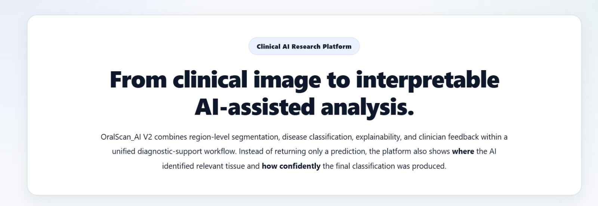
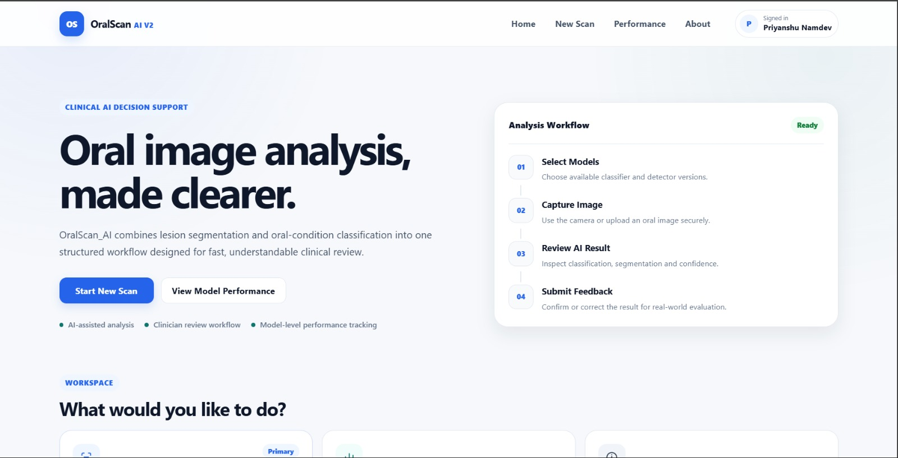
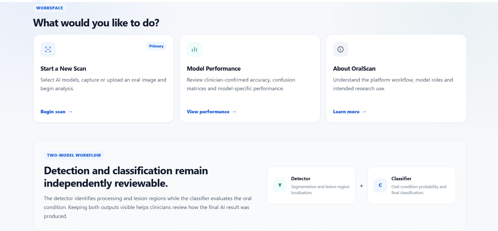
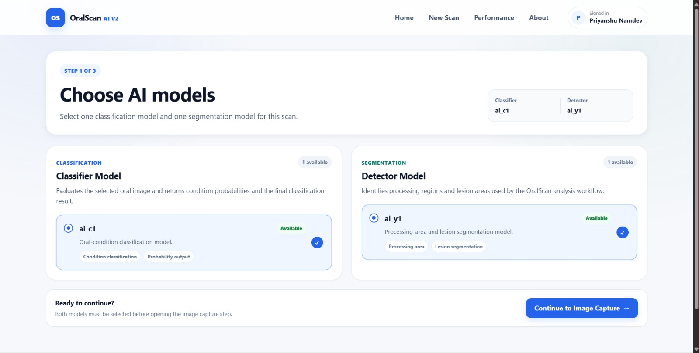
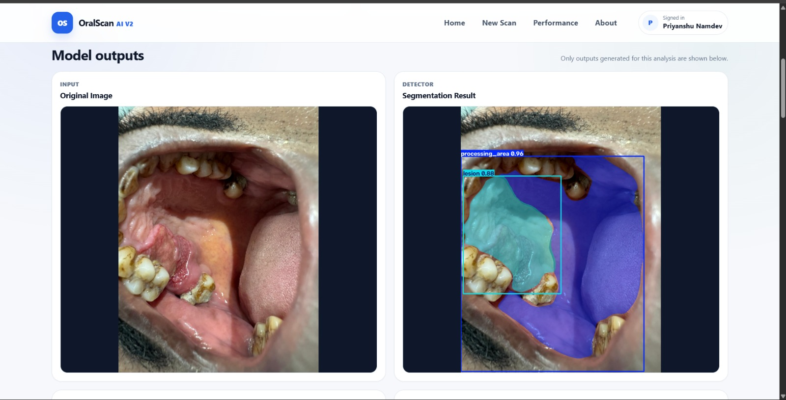
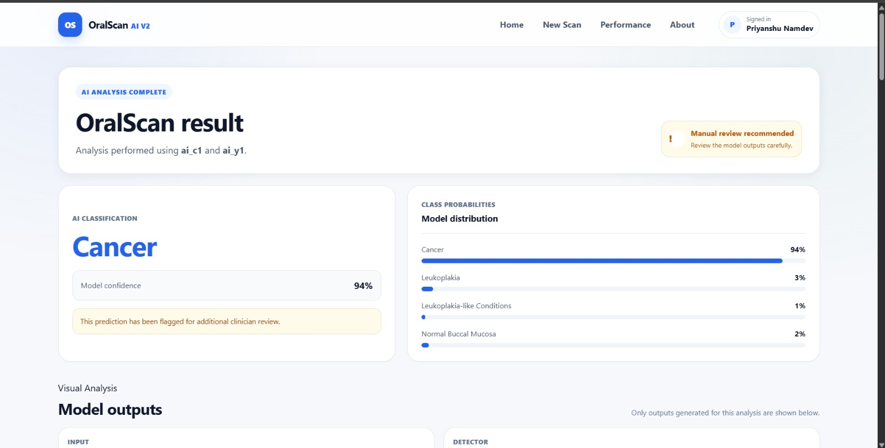
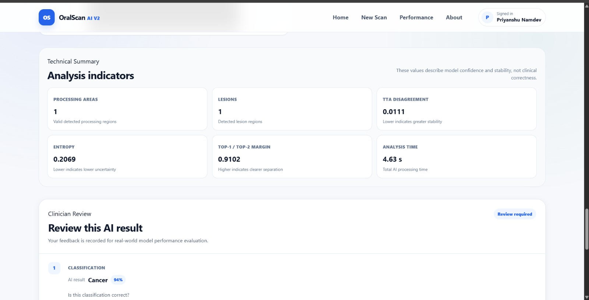
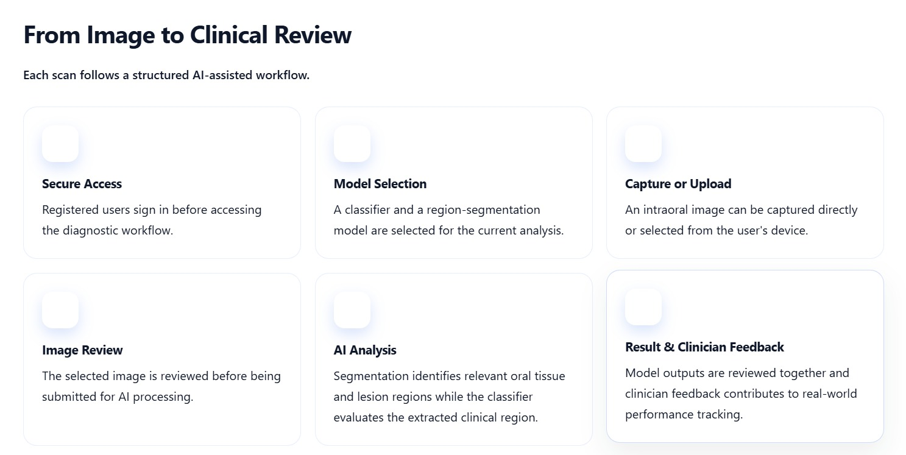
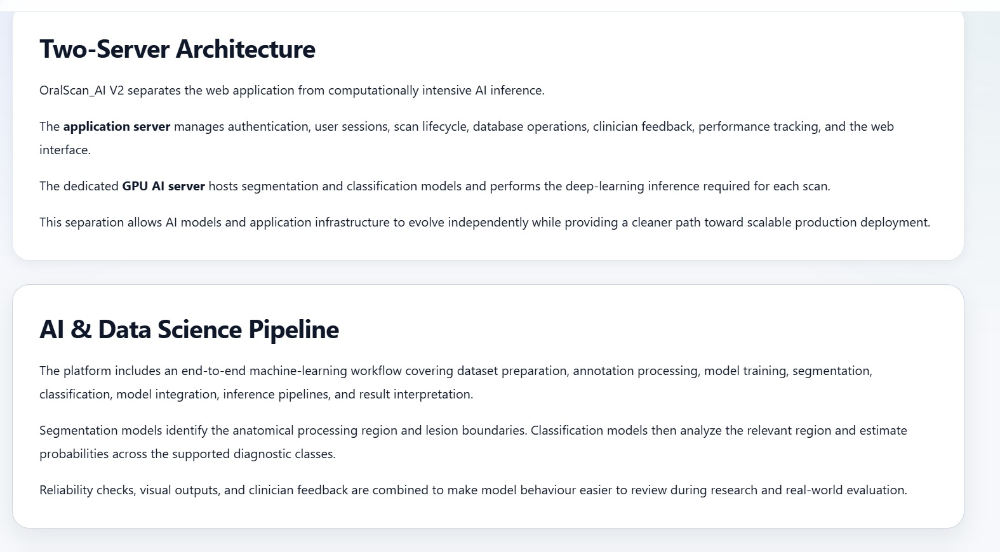
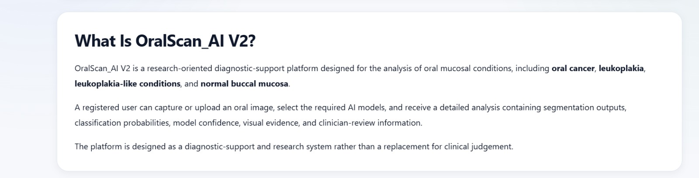

# OralScan AI V2

**From clinical image to interpretable AI-assisted analysis.**

OralScan AI V2 is a research-oriented platform for AI-assisted oral image analysis. It combines region-level segmentation, disease classification, model confidence, visual evidence, and clinician feedback in a single workflow.

Instead of returning only a prediction, the platform helps users examine the relevant image regions, understand the classification results, and review model performance through clinician feedback.

> **Important:** OralScan AI V2 is designed for research and diagnostic support. It does not replace professional clinical judgement.

## Platform Overview

The platform supports the analysis of oral mucosal conditions, including oral cancer, leukoplakia, leukoplakia-like conditions, and normal buccal mucosa.

Registered users can capture or upload an intraoral image, select the required AI models, and review the analysis results through a dedicated interface.

The workflow brings image processing, model inference, result interpretation, and clinician review together in one place.

## Key Features

- **Image capture and upload** for oral image analysis.
- **Model selection** to choose the classifier and segmentation model for a scan.
- **Region-level segmentation** to highlight relevant tissue and lesion regions.
- **Disease classification** with probabilities across supported classes.
- **Model confidence and analysis details** to help interpret the output.
- **Clinician feedback** for reviewing classification and lesion detection results.
- **Performance tracking** to evaluate individual models using reviewed predictions.
- **Separated application and AI infrastructure** for managing web operations and deep-learning inference independently.

## Application Dashboard

The dashboard provides an entry point to the platform's scan workflow and related features.

Additional dashboard features support navigation through the platform and access to its main functions.

## Model Selection

Users can select the required classification and segmentation models before running an analysis. Keeping these stages distinct makes it possible to review the outputs of each model as part of the overall workflow.

## Segmentation Results

The segmentation stage identifies relevant regions in the oral image, including areas associated with a suspected lesion. These visual outputs provide spatial context for reviewing the AI analysis.

## Classification Confidence and Analysis Details

The classification stage estimates probabilities across the supported diagnostic classes. Model confidence and additional analysis information help users inspect the results rather than relying on a single predicted label.

The outputs should be interpreted in the context of the model, available data, and clinical review. Confidence values alone do not establish diagnostic certainty.

## Clinical Workflow

The platform follows a structured workflow from image submission to clinician review.

1. **Secure access** — Registered users sign in to the platform.
2. **Model selection** — The required classification and segmentation models are selected.
3. **Image capture or upload** — An intraoral image is captured or selected from the user's device.
4. **Image review** — The image is reviewed before processing.
5. **AI analysis** — The segmentation and classification models process the image.
6. **Result review** — The user examines the visual outputs, class probabilities, and available confidence information.
7. **Clinician feedback** — Reviewed predictions are recorded to support model evaluation.

## AI Pipeline and System Architecture

OralScan AI V2 separates the web application from computationally intensive AI inference through a two-server architecture.

### Application Server

The application server manages:

- Authentication and user sessions
- Scan lifecycle and database operations
- Web interface and result presentation
- Clinician feedback
- Performance tracking

### Dedicated GPU AI Server

The AI server hosts the segmentation and classification models and performs the deep-learning inference required for each scan.

This separation allows the application layer and AI models to evolve independently, providing a foundation for future scaling and deployment improvements.

## About the Project

OralScan AI V2 brings together the major stages of an applied computer-vision workflow: dataset preparation, annotation processing, model training, segmentation, classification, inference integration, and result interpretation.

Its focus is not only on generating predictions, but also on making model outputs easier to inspect and evaluate through visual evidence and clinician-reviewed feedback.

## Clinician-Reviewed Model Evaluation

Classification and lesion detection are tracked independently. Clinician feedback can record whether a prediction or detection was correct and, where applicable, provide the actual diagnosis.

Reviewed predictions can support the calculation of:

- Overall accuracy
- Per-class performance metrics
- Misclassification patterns
- Confusion matrices for individual models

The reliability of these metrics depends on the quality and quantity of reviewed cases. They support model evaluation and should not be interpreted as proof of clinical validity.

## Disclaimer

OralScan AI V2 is a research-oriented diagnostic-support platform. Its outputs are not a substitute for professional examination, diagnosis, or treatment recommendations. All results should be interpreted by qualified healthcare professionals in the appropriate clinical context.

---

**OralScan AI V2 — Interpretable AI-assisted oral image analysis.**
